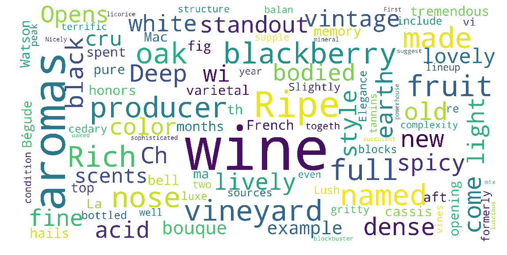
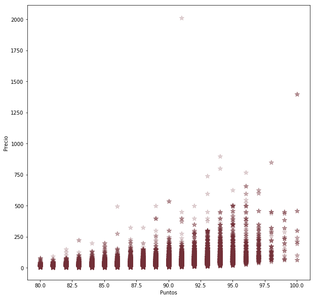
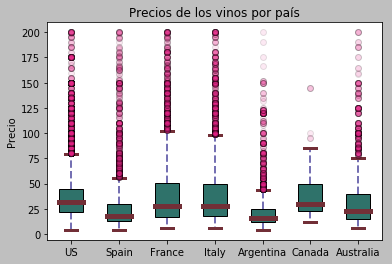

# Wine Data Viz

> An old project I dug out of my archive and uploaded as-is (lightly cleaned). This was **Episode 1** of **"Jugando con Datos,"** a live-streaming series I ran back around 2018 where I explored datasets in Python on the fly — the one that started it all.

Exploratory data analysis and visualization of the WineEnthusiast wine-reviews dataset (~130k reviews). A for-fun project, but it covers the basics: `pandas` for cleaning and wrangling, `seaborn`/`matplotlib` for charts, `scipy` for a bit of stats, and `wordcloud` for text. The analysis and commentary inside the notebooks are in Spanish, from the streams.

## A few of the charts

Word cloud of the tasting notes — what language wine reviewers actually use:



Price vs. rating — do more expensive wines score higher?



Price distribution by country:



## What's inside

| File | What it is |
|---|---|
| `wine-analysis.ipynb` | The main notebook — objective, loading, cleaning in pandas, and the visualizations (well narrated). |
| `live-stream-ep1.ipynb` | The raw notebook from the live stream itself — mostly code, kept for authenticity. |
| `wine-mask.jpg` | Mask image used to shape the word cloud. |

> **Note on the data:** the raw dataset (~130 MB) is **not** included here to keep the repo light. Download it from Kaggle (link below) and drop the files in this folder to run the notebooks.

## Run it

```bash
pip install pandas numpy matplotlib seaborn scipy wordcloud pillow
# download the dataset from Kaggle into this folder first (see below)
jupyter notebook wine-analysis.ipynb
```

## Data

Wine Reviews dataset from [Kaggle](https://www.kaggle.com/zynicide/wine-reviews) (scraped from WineEnthusiast by zackthoutt). Used here for non-commercial, educational purposes.

---

<sub>Episode 1 of my "Jugando con Datos" live-stream series (~2018). Archived and lightly cleaned up. — Jonas López</sub>
